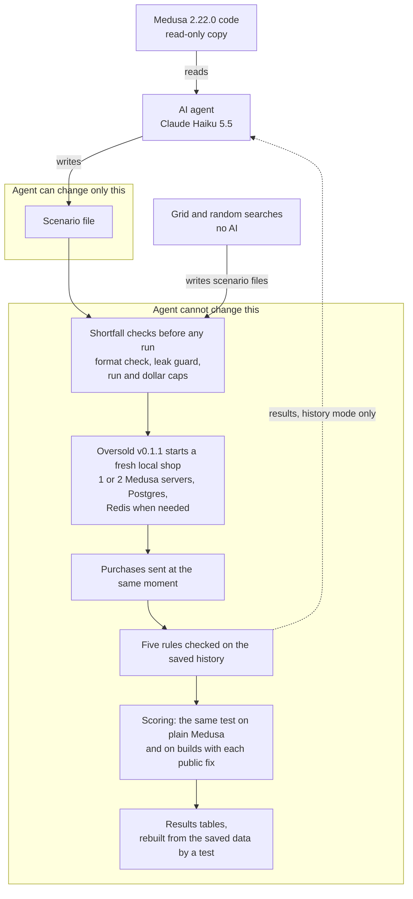

# Shortfall

Shortfall looks for a kind of bug in online shop software that only shows up when several customers act at the same moment. It uses an AI model to guess where these bugs hide, and it tests every guess on a private copy of the shop running on one computer.

## What we found

- A simple fixed list of tests found all three known bug scenarios in every one of its 10 tries. The AI agent found all three in at most 3 of 10.
- When the agent found the "last item sold twice" scenario, it had the lowest median: 33 runs, against 58.5 for the fixed list. Once its misses count, this speed gap could be chance. On the reserved-count scenario the fixed list tied it at 33.
- The agent stopped early, after a median of 33 to 43 of its 300 runs. Showing it its test results made it do worse.
- One agent try cost under 2 US cents and took about 4 minutes. The full results, their limits and how to check them are in [RESULTS.md](RESULTS.md).

## The problem, in everyday terms

A shop has one item left, and two people press Buy at the same moment. A correct shop sells the item once and tells the second person it is sold out. Some shops sell it twice, because both purchases check the stock before either one has taken the item. The shop then owes someone an item it does not have.

## What Shortfall does

1. It reads the code of an open-source shop engine called Medusa.
2. It guesses where purchases made at the same moment could break a rule, such as "never sell more than you have".
3. It writes a small test for that guess: which items are in stock, how many shoppers there are, and when they press Buy.
4. It runs the test many times on a private copy of the shop on this computer.
5. It counts a bug only if the test shows the rule breaking, and a copy of the shop with the public fix for that bug passes the same test.

## How it works



The AI agent, Claude Haiku 5.5, reads a read-only copy of Medusa 2.22.0's code and writes test scenario files, while the grid and random searches write the same kind of file with no AI. Before any run, Shortfall checks each file's format, holds every trial to its run and dollar caps, and ends an agent trial if the benchmark's case names, answer files or fix names would reach the model. Oversold, pinned to v0.1.1, then starts a fresh local copy of the shop with one or two Medusa servers, Postgres, and Redis when the test needs it, sends the purchases at the same moment, and checks the five rules on the saved history. Scoring runs the same test on plain Medusa and on builds with each public fix, and a test rebuilds every results table from the saved data. The agent can change only its own scenario files, never the checks, Oversold, the scoring or the answers, and only in history mode do the results of its runs go back to it.

## What has been measured so far

A run is one go of a test: a fresh copy of the shop starts, the shoppers press Buy, and the result is checked against the rules.

The benchmark has three test scenarios built from two real Medusa bugs that were already public. Each was run 30 times on plain Medusa 2.22.0 and 30 times on a copy with the public fix.

| Test scenario | Public bug | Rule broken on plain Medusa | Rule broken with the fix |
|---|---|---|---|
| The last unit is sold twice | [#17032](https://github.com/medusajs/medusa/issues/17032) | 23 of 30 runs | 0 of 30 runs ([fix #17420](https://github.com/medusajs/medusa/pull/17420)) |
| The count of reserved stock goes wrong | [#17032](https://github.com/medusajs/medusa/issues/17032) | 30 of 30 runs | 0 of 30 runs ([fix #17420](https://github.com/medusajs/medusa/pull/17420)) |
| Two cart lines that use the same stock are oversold | [#16502](https://github.com/medusajs/medusa/issues/16502) | 30 of 30 runs | 0 of 30 runs ([fix #16961](https://github.com/medusajs/medusa/pull/16961)) |

Two simple methods that use no AI were measured for comparison, each in 10 trials of at most 300 runs:

- A fixed list of test shapes found all three scenarios in every one of its 10 trials.
- Randomly drawn tests found the #17032 counter scenario in 10 of 10 trials, the #17032 last-unit scenario in 9 of 10 and the #16502 scenario in 7 of 10, and all three in 6 of 10.

## What the agent has done so far

The AI agent has run trials with the model Claude Haiku 5.5. In an unguided trial it gets no bug report and has the same 300-run budget as the two simple methods above. It ran 10 unguided trials in each of its two feedback modes:

- With no feedback on its results, it reproduced both #17032 scenarios in 7 of 10 trials, at a median of 33 runs, and the #16502 scenario in 3 of 10.
- With feedback on its results, it reproduced the #17032 counter scenario in 6 of 10 trials, the #17032 last-unit scenario in 5 of 10, and the #16502 scenario in 2 of 10.
- It reproduced all three scenarios in one trial in 3 of 10 trials with no feedback, and never with feedback. The fixed list of test shapes did that in every trial.
- On the #17032 counter scenario, the fixed list tied the agent with no feedback: a median of 33 runs each.

A further 10 trials tested whether the agent's list of likely causes helps, by leaving it out. Without it, the agent reproduced both #17032 scenarios in more trials, 9 of 10, and the #16502 scenario in none.

It has also run 18 guided trials, where it is given the public bug report, like an open-book test. Each trial and its full record is on [the agent trials page](benchmark/agent/README.md).

## Limits

- 10 trials per method.
- One AI model (Claude Haiku 5.5).
- The agent was compared on one Medusa version (2.22.0). The bugs themselves were reproduced on 2.19.0, 2.21.2 and 2.22.0.
- Three test scenarios from two public bugs, in one shop engine.
- In every published trial, the agent stopped on its own after at most 76 of its 300 runs.
- False alarms on fixed builds were not tested.
- The statistics tests were chosen after seeing the data.

The rest are in [RESULTS.md, section 8](RESULTS.md#8-limits).

## Why you can trust the numbers

- Every run is saved in this repo with its full record, and every result is recomputed from those records automatically on each change.
- The benchmark uses two real bugs that were already public, turned into three test scenarios.
- Every test runs on private copies of the shop on one computer, never on live shops or anyone's servers.

## Glossary

- **Run**: one go of a test on a fresh copy of the shop, checked against the rules afterwards.
- **Scenario**: the small test file that says which items are in stock, which shoppers there are and when they press Buy.
- **Check**: a rule the shop must keep, checked after every run, such as "never sell more than the stock".
- **Control**: the same scenario run on a fix build, to show that a failure comes from that bug and not from something else.
- **Fix build**: a copy of Medusa with the public fix for one bug applied.
- **Baseline**: a simple method that uses no AI, measured the same way as the agent so its results can be compared.

## How it uses Oversold

Shortfall runs every test through [Oversold](https://github.com/akallam04/oversold), a separate tool that starts Medusa in Docker, sends the requests a scenario describes and checks the rules. Shortfall uses only Oversold's command line, from a clone pinned to one public commit in `oversold.lock`. `make oversold` clones that commit into `.oversold/`, checks it, builds it and makes the clone read-only.

## The engine

Oversold runs on Shortfall's own Docker engine, a [Colima](https://github.com/abiosoft/colima) VM named `shortfall` that can see only this folder. Every image a run uses comes from the pinned clone: the Medusa images it builds and the public base images its Compose file and Dockerfile name. `scripts/oversold.sh` is the only way Shortfall runs Oversold. It checks the pin, sends every run to that engine and writes run folders to `runs/`.

## How to run

```bash
make venv PYTHON=python3.14
```

```bash
make oversold
```

```bash
make test
```

```bash
make lint
```

Runs on Medusa need the engine and Oversold's Postgres:

```bash
make engine-up
```

```bash
sh scripts/oversold.sh up
```

When the runs are done, stop them in the reverse order:

```bash
sh scripts/oversold.sh down
```

```bash
make engine-down
```

## The agent

`src/shortfall/agent.py` runs one trial of the agent. The model can list, read and search the Medusa 2.22.0 source, submit an attempt (a file, a cause from a fixed list, the check it expects to fail, a short hypothesis and a scenario) and finish with its claims. Prompt version v2-nomenu leaves out the list of causes, and the agent names only a file. Each attempt and its prediction go into `runs/ledger.jsonl` before its first run, and each is scored the same way as the baselines. A trial stops at 300 runs, 30 attempts, 100 model turns or a dollar cap (12 attempts and 60 turns on prompt version v1). In the `none` feedback mode the model only learns whether an attempt was accepted or refused, and how many attempts and turns are left (on v1 also how many runs). In the `history` mode it also sees, for the runs on plain Medusa only, how often each check failed and a short summary of each run. It never sees control runs, the benchmark cases or their answers. The prompts are in `src/shortfall/prompts/`, and the scenario format text the model reads is built from the same list of fields that the candidate check accepts, in `src/shortfall/scenario_format.py`. One sha256 over everything the model is shown and the loop settings is kept in [benchmark/agent/prompts.sha256](benchmark/agent/prompts.sha256).

`src/shortfall/models.py` connects the agent to Claude through the official `anthropic` Python SDK, pinned in `pyproject.toml`. It knows `claude-haiku-5-5` and `claude-sonnet-5-5`. Each call may write up to 2,000 output tokens and runs without extended thinking (on Claude Sonnet 5.5, which cannot turn thinking off, at its lowest setting). The tool definitions and the system prompt are cached, and a second cache marker moves along the conversation to the last message that the next turn will send unchanged. Prices are dated constants taken from the [pricing page](https://platform.claude.com/docs/en/about-claude/pricing). Before each call the trial reserves the most the call could cost, and afterwards it records the real cost from the response's usage: input, cache write, cache read and output tokens. A call that would pass the trial's dollar cap or the $20 total is not made. Rate-limit and server errors are retried at most twice, and billing or authentication errors end the trial. The API key is read only from `.env`, which git ignores, and anything that looks like a key is masked in the ledger and in transcripts.

`src/shortfall/trials.py` runs a plan of trials, such as [benchmark/agent/plans/guided-haiku-1.yaml](benchmark/agent/plans/guided-haiku-1.yaml), in round-robin order. Before each trial it checks the engine, the image ids, the prompt hash, the Oversold pin, the dollar room and the free disk space, and it stops the plan on any mismatch. A trial that was interrupted is rerun from the start with a new id. Each finished trial is exported under `benchmark/agent/<plan>/`, its histories are verified, and its files are scanned for local paths and keys before it counts as exported. A plan with a real model needs the key in `.env` (copy `.env.example`), the engine and Oversold's Postgres:

```bash
.venv/bin/python -m shortfall.trials benchmark/agent/plans/guided-haiku-1.yaml --raise-dollar-cap 3
```

```bash
.venv/bin/python -m shortfall.trials --status benchmark/agent/plans/guided-haiku-1.yaml
```

## Benchmark

Each folder in [benchmark/cases/](benchmark/cases/) is one public bug. `case.yaml` names the issue, the rule it breaks, the Medusa versions, the controls and what the agent may see. `reference.yaml` is a scenario written by hand that reproduces it. `results/` holds every measured run with its full history, gzipped, so `oversold check --verify` can recompute every verdict. [benchmark/README.md](benchmark/README.md) has the measured results, the scoring rules and the baselines.

## Safety

Shortfall only runs engines on local copies that Oversold starts in Docker, never on live stores or anyone's servers. A bug that no public issue already covers is reported privately to that project first.

## License

MIT. See [LICENSE](LICENSE).
