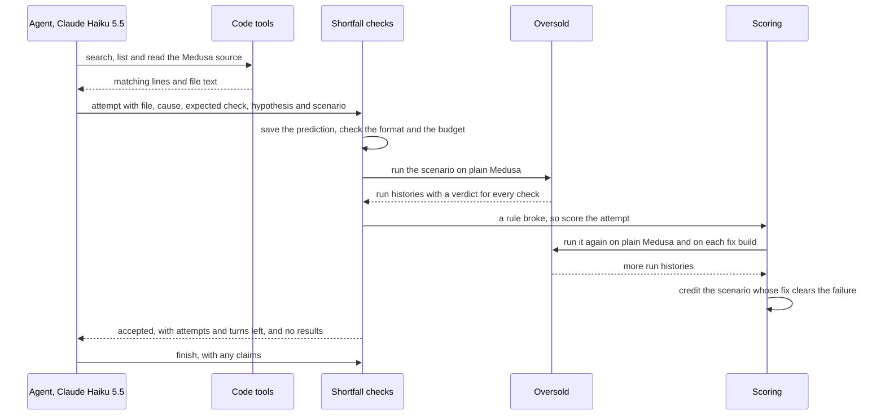

# One trial, step by step

This page follows one real trial, [unguided-none-5](benchmark/agent/scale-10/unguided-none-5/), so you can see exactly what the AI agent did: Claude Haiku 5.5 on prompt v2, with no feedback on its results. It was picked because it is easy to follow: its first test reproduced both race scenarios, credited at run 33, it named the right place before any run, and it read the locking code where the bug lives. It is one example, not a typical result. Across the [full table](RESULTS.md#how-often-and-how-fast-each-method-reproduced-each-scenario), 7 of 10 no-feedback Haiku trials reproduced both race scenarios, and 3 of 10 found all three scenarios.



## What the agent was given

The task: there is no bug report, so read the shop's code and decide which stock or order rule might break. The agent could use five tools. Three read Medusa 2.22.0's source (`list_files`, `read_file`, `search`), `submit_attempt` sends a test, and `finish` ends the trial with claims. The trial had at most 300 runs, 30 attempts and 100 turns, a turn being one reply from the model.

It got no bug report, no benchmark scenarios or answers, and no Enterprise Edition files. In this mode it never sees run results either: after each attempt it only hears that the attempt was accepted, and how many attempts and turns are left.

Its instructions and the loop's settings are fixed by one hash before the trial: the [system prompt](src/shortfall/prompts/system.md), the [test setup](src/shortfall/prompts/setup.md), the [unguided task](src/shortfall/prompts/unguided.md), the [scenario format](src/shortfall/scenario_format.py) and the [hash file](benchmark/agent/prompts.sha256), which lists every file it covers. The Medusa code it reads is pinned by the [2.22.0 snapshot record](benchmark/snapshots/medusa-2.22.0.json), which names the git tag and commit the code was taken from and holds a sha256 of its files.

## What it read

Each row is one tool call, and one reply can make more than one call, so 15 calls took 11 turns.

| Step | What it did | Why it mattered |
|---|---|---|
| 1 | Searched `packages/core/core-flows/src` for `reserveInventory` | Found where checkout reserves stock. |
| 2 | Searched `packages/core/core-flows/src` for `completeCartWorkflow` | Found the checkout workflow. |
| 3 | Read `packages/core/core-flows/src/cart/steps/reserve-inventory.ts`, lines 55 to 116 | Saw the stock check run inside a lock. |
| 4 | Read `packages/core/core-flows/src/cart/workflows/complete-cart.ts`, lines 560 to 680 | Saw checkout call that step. |
| 5 | Searched `packages/core/core-flows/src/cart/workflows/complete-cart.ts` for `completed_at` | Looked for a guard against double checkout. |
| 6 | Listed `packages/modules/locking` | Turned to the locking module. |
| 7 | Read `packages/core/core-flows/src/cart/workflows/complete-cart.ts`, lines 354 to 420 | Saw checkout lock the cart. |
| 8 | Searched `packages/core/core-flows/src/cart` for `already been completed` | Found no such message. |
| 9 | Searched `packages/modules/locking/src` for `class` | Found the default lock, `InMemoryLockingProvider`. |
| 10 | Read `packages/modules/locking/src/providers/in-memory.ts`, lines 1 to 60 | Saw the lock live inside one server. |
| 11 | Sent attempt 1 | The test below. |
| 12 | Searched `packages/core/core-flows/src/cart/utils/prepare-confirm-inventory-input.ts` for `location_ids` | Turned to a second idea. |
| 13 | Read `packages/core/core-flows/src/cart/utils/prepare-confirm-inventory-input.ts`, lines 150 to 305 | Saw each line checked against stock alone. |
| 14 | Sent attempt 2 | A second test. |
| 15 | Called finish with no claims | Ended the trial itself. |

The key read is the last one before the first attempt. The default lock keeps its locks in a Map, a lookup table in one server's memory ([in-memory.ts at v2.22.0](https://github.com/medusajs/medusa/blob/v2.22.0/packages/modules/locking/src/providers/in-memory.ts#L16-L19)):

```ts
export class InMemoryLockingProvider implements ILockingProvider {
  static identifier = "in-memory"

  private locks: Map<string, LockInfo> = new Map()
```

A second server has its own Map and never sees these locks.

## What it guessed, before any run

With its first attempt the agent saved this guess, before any run, so it cannot change once results exist.

| Saved before any run | Value |
|---|---|
| File | `packages/modules/locking/src/providers/in-memory.ts` |
| Cause | `process-local-lock` |
| Check it expected to fail | `no_oversell` |
| Named the right place | yes, for medusa-17032-last-unit and medusa-17032-counter |

Its hypothesis began:

> The default locking provider is InMemoryLockingProvider, whose lock lives in one process's Map. The inventory reservation step (reserve-inventory.ts) and the cart completion lock both rely on it.

## The test it wrote

It starts two Medusa servers that share one database, sets the stock of an item called SOLO to 1 unit, and builds two carts, one on each server, each holding that item. Then both carts go to checkout at the same moment. A correct shop sells the unit once and refuses the second checkout.

<details>
<summary>The full scenario file</summary>

```yaml
schema: oversold.scenario/v1
name: attempt-01-agent-20261118t060622z
description: Two carts each need the single SOLO unit and are completed on different
  servers at the same time.
target:
  engine: medusa
  version: 2.22.0
  servers: 2
stock:
  SOLO: 1
carts:
  alice:
    server: 1
    lines:
    - sku: OVS-SOLO
      qty: 1
  bob:
    server: 2
    lines:
    - sku: OVS-SOLO
      qty: 1
race:
- id: alice-completes
  server: 1
  do: complete
  cart: alice
- id: bob-completes
  server: 2
  do: complete
  cart: bob
timing:
  release: together
  jitter_ms:
  - 0
  - 3
faults: []
runs: 20
seed: 7
```

Shortfall decides how many runs each set does, so the file's `runs: 20` is not used. Its `seed: 7` is used, and every run record shows it.

</details>

## What Oversold found

Oversold ran the test on fresh copies of the shop and checked five rules after every run. Each cell counts runs where that rule broke.

| Build | Runs | no_oversell | reserved_matches_reservations | one_order_per_cart | no_orphaned_orders | no_missing_orders |
|---|---|---|---|---|---|---|
| Plain Medusa 2.22.0 | 13 | 7 | 7 | 0 | 0 | 0 |
| With the #16502 fix, pr-16961 | 10 | 7 | 7 | 0 | 0 | 0 |
| With the #17032 fix, pr-17420 | 10 | 0 | 0 | 0 | 0 | 0 |

The 13 plain runs are 3 first runs, in sets of 1 and 2, then 10 more because a check failed in those first runs, and each fix build ran 10.

On plain Medusa the last unit was sold twice and the count of reserved stock went wrong. The #16502 fix did not clear this, so the two-lines scenario gets no credit. The #17032 fix cleared both rules, and the fix that clears a failure decides the credit, so both race scenarios were credited at run 33, when the last of these runs finished.

<details>
<summary>One failing run, in short</summary>

This is trimmed from Oversold's record to the two checkout calls and the two failed checks, and the full record is [run 2 of the second plain set](benchmark/agent/scale-10/unguided-none-5/runs/20261118T060640Z-attempt-01-agent-20261118t060622z-2.22.0/run-002.json.gz). Both checkouts succeeded, and two orders hold reservations for a unit that was stocked once.

```json
{
 "race": [
  {"id": 22, "step": "complete_cart", "cart": "alice", "server": 1, "status": 200, "outcome": "ok"},
  {"id": 23, "step": "complete_cart", "cart": "bob", "server": 2, "status": 200, "outcome": "ok"}
 ],
 "failed checks": [
  {"check": "no_oversell", "result": "fail", "reason": "SOLO live reservations 2 exceed stocked 1; SOLO orders need 2 units but 1 were stocked at the start of the race"},
  {"check": "reserved_matches_reservations", "result": "fail", "reason": "SOLO reserved_quantity 1 but live reservations sum to 2"}
 ]
}
```

</details>

## How it ended

| How it ended | Value |
|---|---|
| Attempts | 2 |
| Claims | 0 |
| Claims backed by a violation | 0 |
| Runs used | 43 of 300 |
| Turns | 11 of 100 |
| Cost | $0.0058 |
| Time | 4.2 minutes |

Its second attempt tested the line-by-line stock check with two separate carts, which cannot trigger the two-lines bug, so nothing broke. It then called finish with no claims, having never seen a result: "No claims are made until the results confirm a real failure." Its success shows only in the scoring.

## What a miss looks like

Trial [unguided-none-4](benchmark/agent/scale-10/unguided-none-4/) read much of the same code, and its own summary named both likely problems: the lock that works inside one server only, and the stock check that looks at each line alone. It tested only the second, with two one-line carts on one server, while the two-lines bug needs both lines in the same cart, so nothing broke. It sent one attempt, used 10 of its 300 runs and 11 turns, and called finish, long before its budget ran out.

## A bigger model, briefly

Trial [sonnet-none-6](benchmark/agent/followups-1/sonnet-none-6/) ran Claude Sonnet 5.5 on the same task and prompt, and reproduced all three scenarios with no hold or refused attempt.

| Attempt | What it tested | Rules broken on plain Medusa | Reproduced (run) |
|---|---|---|---|
| 1 | One cart, two lines sharing an item, more than the stock | `no_oversell` in 13 of 13 runs | medusa-16502-lines (run 23) |
| 2 | Carts on both servers for the one SOLO unit | `no_oversell` and `reserved_matches_reservations` in 10 of 13 runs | medusa-17032-last-unit (run 66), medusa-17032-counter (run 66) |
| 3 | Each cart sent to checkout on both servers at once | `reserved_matches_reservations` in 13 of 13 runs | medusa-17032-counter (run 89) |
| 4 | Many carts sharing an item, plenty of stock | `reserved_matches_reservations` in 13 of 13 runs | medusa-17032-counter (run 112) |

It used 112 runs and 21 turns, took 17.8 minutes and cost $0.4127, against $0.0058 for the Haiku trial above.
